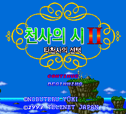

# 천사의 시 II ~타천사의 선택~ — PC Engine Super CD-ROM²

PC Engine Super CD-ROM² **천사의 시 II ~타천사의 선택~** 한글 번역 패치 프로젝트입니다. 마을과 필드를 탐험하며 이야기를 진행하는 판타지 RPG 시리즈 두 번째 작품의 PC Engine CD판입니다.

> **정식 배포 v1.0**

개발용: [v1.0(b64) 소스 재빌드 안내](docs/REBUILD_B64_2026-10-16.md). 보유한 원본과 도구로 공식 디스크·시스템 카드·Redump Track 02를 재현한다.

2026-10-16 로컬 게임 폴더는 사용자 요청으로 삭제했다. [정리·복원 인계](docs/PCE_CLEANUP_2026-10-16.md)에 보존 자료와 복원 방법을 기록했다.

<!-- game-preview:start -->

  

**한글 타이틀 · v1.0** — release_Tenshi2_KR_v1.0_20261014 pce_fast 캡처
<!-- game-preview:end -->

## 다운로드 및 적용 방법

1. 아래 체크섬 또는 상세 안내와 일치하는 원본을 준비합니다.
2. [최종 배포 패치 다운로드](https://github.com/akuma815/pce-tenshi-no-uta-2-kr-patch/releases/tag/v1.0)에서 ZIP을 받아 모두 압축 해제합니다.
3. `Tenshi2KR_Patcher.exe`에서 원본 CUE와 원본 시스템 카드 PCE를 선택합니다.
4. 필요하면 BizHawk 실행 파일을 지정하고, 패치 및 바로가기를 생성합니다.
5. 에뮬레이터에 생성된 `_KR.cue`와 `SystemCard3_KR.pce`를 함께 지정합니다.

## 주의사항

- 원본 디스크와 일본판 Super System Card 3.0을 직접 준비해야 합니다.
- 단일 BIN과 Redump 멀티 BIN은 각 전용 패치를 사용합니다.
- 에뮬레이터에는 패치된 디스크와 패치된 시스템 카드를 함께 지정합니다.
- 이전 버전의 세이브스테이트는 사용하지 마세요. 지원 에뮬레이터와 세이브 이전은 동봉 안내를 따르세요.
- 원본 게임·BIOS 및 패치가 적용된 게임 이미지는 포함하지 않습니다.

## 체크섬

| 구분 | SHA-256 |
| --- | --- |
| 원본 단일 BIN | `d16d29eb80b1b74a2ec929924349256b50b8f9f5c9a3fa37b6fcc08b059b22c5` |
| 원본 System Card 3.0 (J), 헤더 없음 | `e11527b3b96ce112a037138988ca72fd117a6b0779c2480d9e03eaebece3d9ce` |
| 패치 파일 `SystemCard3_KR.xdelta` | `842dcd04af66661c523ee7119ea4cf6e521c574c212d67ae0748122420ca64e5` |
| 패치 파일 `SystemCard3_KR_from_v0.3.xdelta` | `e40c7a3c36d33c9ddc17730c9156fd98bc49bfde7e97c56e1bb2bd731807f05d` |
| 패치 파일 `Tenshi_no_Uta_II_KR_disc.xdelta` | `209df59789ec3d4499346180858c4d77a2706fc59ef172d58cc9b1f4c8168d62` |
| 패치 파일 `Tenshi_no_Uta_II_KR_disc_from_v0.3.xdelta` | `4832b17094b6d9ae0480f214f2832a216d97ebfbe567a68e6f2f8ccd250fd46f` |
| 패치 파일 `Tenshi_no_Uta_II_KR_track02_redump.xdelta` | `4b8cdbf3e1fe003be574078b68314784bb23e261b46492cf4221070f499b0ef3` |
| 패치 파일 `Tenshi_no_Uta_II_KR_track02_redump_from_v0.3.xdelta` | `fc31e6f130302669604495fa3435ea984f6d4b185a196d53aa92ac0761cdad9c` |
| 배포 압축 파일 | `6b6afac020338584fdb8ced76bff3a0e609418874145bc54ff3683bea0a48fa3` |

지원 원본의 세트·리비전 및 해시는 [상세 패치 안내](docs/PATCH_GUIDE.txt)를 확인하세요.

## 소스 및 작업 기록

[공개 소스 구성과 빌드 전제](docs/SOURCE_GUIDE.md) · [상세 패치 안내](docs/PATCH_GUIDE.txt)
